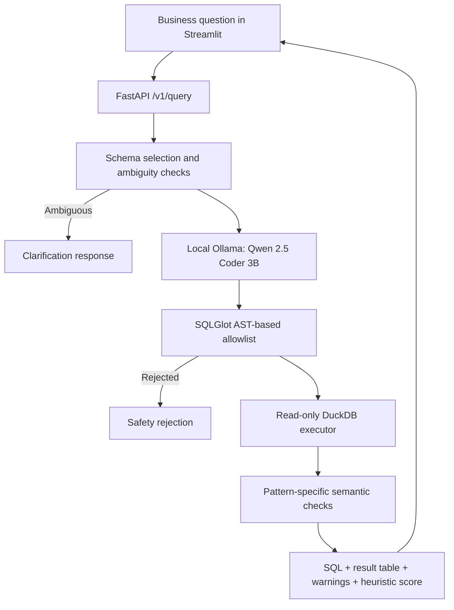
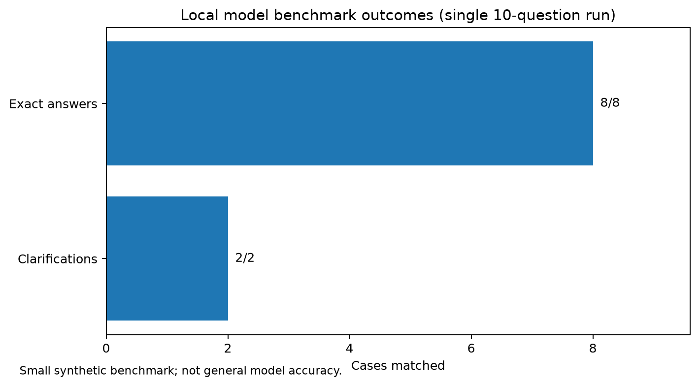
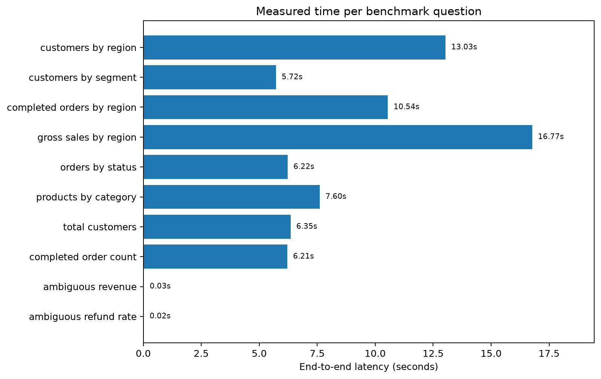
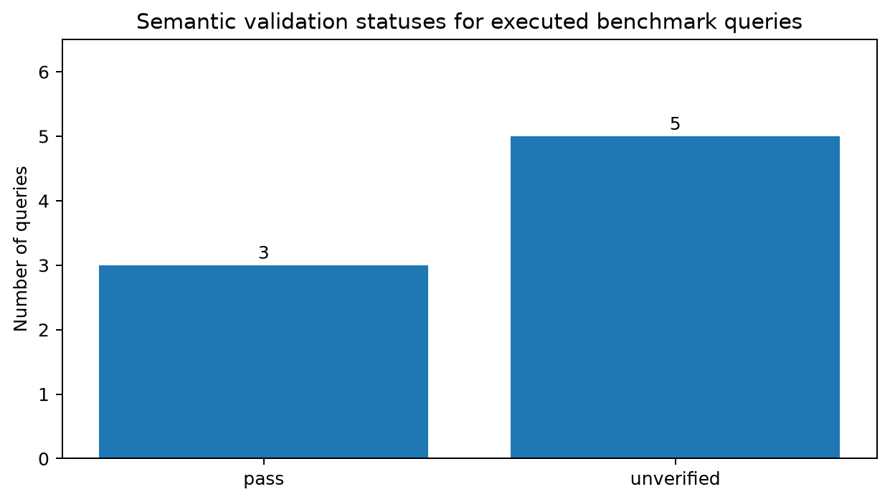
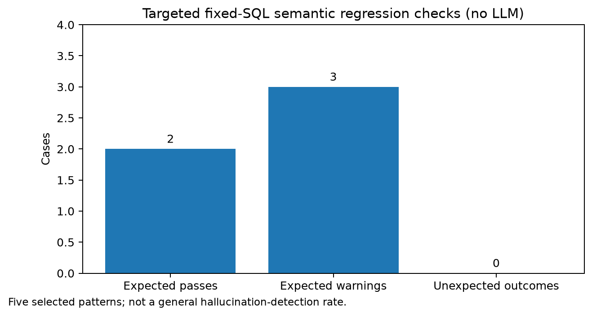

# Safe Text-to-SQL — Local LLM, SQL Guardrails & Answer Validation

A **local-first natural-language analytics application** that translates business questions into SQL, validates candidate queries, executes approved SQL against a synthetic DuckDB database, and displays results with transparent semantic-validation signals.

**Portfolio MVP — not a production-certified system.** The model is pretrained; this project uses **inference, not model training or fine-tuning**.

## At a glance

- **Model:** Qwen 2.5 Coder 3B through local Ollama; no paid inference API.
- **Safety:** SQLGlot AST allowlist plus read-only DuckDB; the model cannot authorize its own SQL.
- **App:** FastAPI backend and Streamlit frontend, both bound to localhost.
- **Observed single-run benchmark:** 8/8 exact answer matches; 2/2 expected clarifications; mean end-to-end latency 7.249 seconds across 10 questions.
- **Targeted semantic regression checks:** 5/5 expected outcomes (2 intended passes, 3 intended warnings), **without LLM inference**.
- **Testing:** 91 automated tests passed locally; GitHub Actions verified for the initial published release.

> **Evaluation caveat:** These are results on a small, synthetic, schema-specific benchmark. There were **zero wrong executed answers** in the live run, so live hallucination-detection recall was **not measurable**. A heuristic score of 100 is *not* a probability of correctness.

## Why build this?

An LLM can generate SQL that executes successfully but answers the wrong business question. For example, `COUNT(*)` after joining customers to orders can count joined order rows rather than unique customers. “Revenue” can also mean gross sales or net revenue. A useful Text-to-SQL system must distinguish **valid SQL** from **a correct business answer**.

## Architecture



The LLM proposes SQL; deterministic code decides whether the query is admitted. The read-only connection provides a second boundary. `LIMIT 1000` limits output rows **but does not limit rows scanned, CPU time, or memory**.

### Worked example

**Question:** “How many customers are in each region?”

```sql
SELECT region, COUNT(*) AS customer_count
FROM customers
GROUP BY region
ORDER BY region
LIMIT 1000;
```

On the shipped synthetic dataset, the result is East: 10, North: 10, South: 10, West: 10. The validator checks supported business rules; its judgment is separate from the benchmark's reference-SQL result comparison.

## Performance evaluation

The following four figures were generated from **one local benchmark run** and a **separate deterministic negative-case regression report**.

### 1. Benchmark outcomes



Eight answerable questions matched independently specified reference SQL results; two ambiguous questions returned the expected clarification status. This is **not a general model accuracy estimate**.

### 2. End-to-end latency per question



Mean latency was **7.249 seconds per question** across all ten cases. The two ambiguity cases took approximately 0.02–0.03 seconds because clarification was handled without model inference. The remaining timings include the complete pipeline, **not model inference alone**.

### 3. Semantic validation coverage



Of eight executed queries, **3 passed** the implemented semantic checks and **5 were classified as unverified**. All eight matched their reference results. *Unverified* means the question type was not covered by the deterministic verifier; it does **not** mean the answer was incorrect.

### 4. Targeted fixed-SQL negative cases (no LLM)



Five known patterns produced their expected outcomes: **2 valid customer-count patterns passed** and **3 incorrect patterns were flagged**. These are fixed-SQL semantic checks, **not** a live hallucination-detection benchmark or a measured detection rate.

### Measured metrics

| Metric | Observed result | Interpretation |
|---|---:|---|
| Exact result matches | 8/8 | Answerable questions in one synthetic benchmark |
| Successful executions | 8/8 | Answerable questions |
| Expected clarification outcomes | 2/2 | Ambiguous cases |
| Mean end-to-end latency | 7.249 s | Across all 10 questions, including fast clarifications |
| Semantic validation coverage | 3 pass, 5 unverified | Among the 8 executed queries |
| Fixed-SQL regression outcomes | 5/5 | 2 expected passes, 3 expected warnings; no LLM |
| Wrong executed answers in live run | 0 | No examples available to measure live detection recall |
| Live wrong-answer detection rate | Not measurable | Denominator was zero |

[Curated evaluation snapshot](evaluation/reports/2026-11-12-summary.json) · [Evaluation methodology and limitations](docs/EVALUATION.md)

## Quick start — run locally

**Prerequisites:** Python 3.11+, Git, and [Ollama](https://ollama.com/download). The first model download requires approximately 1.9 GB of disk space. Run the API and Streamlit **on your own computer**, not on a public server.

On macOS or Linux, in a terminal:

```bash
git clone https://github.com/mohanrameshwara-murugaraj/text-to-sql-guardrails.git
cd text-to-sql-guardrails
python3 -m venv .venv
source .venv/bin/activate
python -m pip install -e '.[dev]'
python -m pip install -r requirements-milestone8.txt
python scripts/build_database.py
ollama pull qwen2.5-coder:3b
pytest -q
```

Make sure the Ollama service is running (launch the Ollama app on macOS, or use `ollama serve` where applicable). Check `ollama list` to confirm that `qwen2.5-coder:3b` is installed.

**Terminal A — API:**

```bash
source .venv/bin/activate
python -m uvicorn text_to_sql.api:app --host 127.0.0.1 --port 8000
```

**Terminal B — frontend (same repository directory):**

```bash
source .venv/bin/activate
python -m streamlit run app/streamlit_app.py --server.address 127.0.0.1
```

Open **http://127.0.0.1:8501** for Streamlit or **http://127.0.0.1:8000/docs** for FastAPI's local API explorer. Try **“How many customers are in each region?”**

**Windows:** activate the environment in PowerShell with `.venv\Scripts\Activate.ps1` instead of `source .venv/bin/activate`. Run the remaining Python commands in the repository directory. Ollama must be installed and running separately.

## Reproduce the evaluations and figures

Run this after generating `data/sales.duckdb` and installing the Ollama model:

```bash
python -m pip install matplotlib
python scripts/evaluate.py
python scripts/evaluate_negative.py
python scripts/plot_evaluation.py
```

- `python scripts/evaluate.py` runs **real local LLM inference** on `evaluation/cases.json` and writes `results/evaluation_latest.json`.
- `python scripts/evaluate_negative.py` checks **fixed SQL patterns without LLM inference** and writes `results/negative_cases_latest.json`.
- `python scripts/plot_evaluation.py` regenerates the four PNG figures in `docs/figures/` from those local outputs.
- `results/` is intentionally gitignored. The versioned [curated snapshot](evaluation/reports/2026-11-12-summary.json) records the reported aggregate evidence without publishing temporary run files.

Your own timing and even generated SQL may differ according to hardware, model version, and inference conditions. GitHub Actions tests deterministic behavior with test doubles; it does **not** rerun the live LLM evaluation.

## Technology and project structure

| Layer | Technology |
|---|---|
| LLM inference | Ollama + Qwen 2.5 Coder 3B |
| Data and schema | DuckDB; Python schema inspection |
| SQL admission | SQLGlot AST allowlist |
| Answer validation | Narrow deterministic semantic checks |
| API and UI | FastAPI + Streamlit |
| Evaluation and visualization | pytest, reference SQL, Matplotlib |
| CI | GitHub Actions |

```text
app/                          Streamlit application
src/text_to_sql/              Schema, prompt, LLM adapter, SQL policy, executor, validation, API
evaluation/cases.json         Ten benchmark cases and reference SQL
evaluation/reports/           Published curated evidence
scripts/build_database.py     Deterministic synthetic database generator
scripts/evaluate.py           Live LLM benchmark
scripts/evaluate_negative.py  Fixed-SQL semantic regression report
scripts/plot_evaluation.py   Regenerate evaluation figures
docs/figures/                 Benchmark graphics
docs/                          Evaluation details, limitations and release notes
tests/                         Automated unit/integration tests
.github/workflows/            Automated CI
```

## Design decisions and known limitations

- **DuckDB** makes the project easy to reproduce without running a PostgreSQL server. It does not demonstrate production multi-user database permissions or concurrency.
- **Local inference** removes paid API requirements but model quality and latency depend on available hardware.
- **SQLGlot allowlisting** is stronger than simple keyword blocking, but does not prove that all referenced columns or joins are semantically correct.
- **Read-only execution** mitigates writes; it does not constitute a complete sandbox. The API has no authentication or rate limiting, and query resource limits are incomplete. **Do not expose the service to the internet or run it on sensitive business data.**
- **Pattern-specific checks** can return `pass`, `warning`, or `unverified`. They are not a universal hallucination detector. Their heuristic scores are not calibrated probabilities.
- **Small benchmark:** one run on ten synthetic, schema-specific questions cannot establish broad SQL-generation accuracy or detection precision/recall.
- The Qwen model was **not fine-tuned or trained** in this project; training-loss or epoch curves would be fabricated.

See [Security and limitations](docs/SECURITY_AND_LIMITATIONS.md) for the complete scope.

## More documentation

- [Project summary](PROJECT_SUMMARY.md)
- [Evaluation methodology](docs/EVALUATION.md)
- [Curated evaluation snapshot](evaluation/reports/2026-11-12-summary.json)
- [Security and limitations](docs/SECURITY_AND_LIMITATIONS.md)
- [Release checklist](docs/RELEASE_CHECKLIST.md)

## Status

**Portfolio MVP completed and published.** The application works locally, has recorded evaluation evidence, and passed automated CI on the published repository. It is **not production-ready**.
