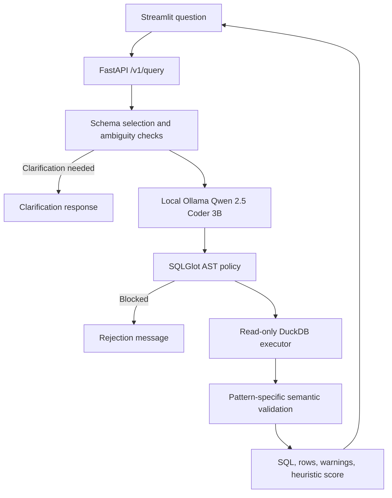

# Safe Text-to-SQL — Local LLM, SQL Guardrails & Answer Checks

**An end-to-end, local-first natural-language interface for querying a synthetic sales database, with a restricted SQL execution policy and transparent answer-validation signals.**

Instead of treating valid SQL as a correct answer, the application separates **generation**, **admission/execution**, and **semantic verification**. It can refuse unsupported requests, ask for clarification on selected ambiguous terms, and warn on specific wrong-query patterns. It is a **portfolio prototype**, not a production-certified security or factuality system.

## At a glance

- **User flow:** English question → schema-aware prompt → Ollama (`qwen2.5-coder:3b`) → candidate SQL → SQLGlot allowlist → read-only DuckDB → semantic checks → FastAPI → Streamlit.
- **Real app:** local browser interface showing SQL, results, timing, and validation details.
- **Measured:** **8/8** exact result matches for answerable questions; **2/2** expected clarification outcomes on a **single, 10-question synthetic-database evaluation**; **7.249 s** mean end-to-end latency per case in that run.
- **Automated tests:** **91 passed, 1 dependency deprecation warning** in the last reported run (2026-11-12), before adding this documentation package. Re-run tests on your machine and CI.
- **Critical caveat:** no wrong executed answers occurred in the live benchmark, so **live wrong-answer detection rate was not measurable** (not 100%).

## Why this exists

A text-to-SQL model may produce executable SQL that measures the wrong business concept. For example, `COUNT(*)` after joining customers to orders can count order rows rather than customers; an apparent “revenue” request might mean gross sales or net revenue. Database execution and SQL syntax validation alone cannot resolve those failures.

## Architecture



**Safety boundary:** the model is not trusted to authorize execution. A deterministic SQL allowlist runs first, and queries use a read-only connection. Supported syntax is deliberately narrow. A `LIMIT 1000` caps returned rows; it **does not** cap scanned rows, compute time, or memory use. Do not expose this prototype directly on the public internet.

## Stack

Python 3.11+, DuckDB, SQLGlot, Ollama (Qwen 2.5 Coder 3B), FastAPI, Streamlit, pytest, GitHub Actions. All data is synthetic. Local development uses no paid API.

## Run locally

Run from the repository root (with Python 3.11+ and Ollama installed):

```bash
python3 -m venv .venv
source .venv/bin/activate
python -m pip install -e '.[dev]'
python -m pip install -r requirements-milestone8.txt
python scripts/build_database.py
ollama pull qwen2.5-coder:3b
pytest -q
```

In terminal A:

```bash
python -m uvicorn text_to_sql.api:app --host 127.0.0.1 --port 8000
```

In terminal B:

```bash
python -m streamlit run app/streamlit_app.py --server.address 127.0.0.1
```

Open **http://127.0.0.1:8501** to ask a question, or **http://127.0.0.1:8000/docs** for the local API explorer. Ollama must be running in the background. Use `ollama list` to confirm the model is installed.

Try: **“How many customers are in each region?”** You should see a grouped count based on the synthetic database. To inspect a query's meaning, review both the generated SQL and any validation warnings; the score is **not a probability**.

## Evaluation

Run a real local inference benchmark:

```bash
python scripts/evaluate.py
```

The script evaluates `evaluation/cases.json` and writes `results/evaluation_latest.json` (a local generated artifact). The benchmark compares result tables to independently specified reference SQL, ignoring output aliases and row order while preserving values and shape.

**Observed run supplied by project author (2026-11-12):**

| Measure | Observed result |
|---|---:|
| Exact result matches / answerable questions | 8 / 8 |
| Successful executions / answerable questions | 8 / 8 |
| Expected clarifications / ambiguous questions | 2 / 2 |
| Mean time per evaluated question | 7.249 s |
| Incorrect executed answers in live benchmark | 0 |
| Live wrong-answer detection rate | **Not defined** (zero wrong answers to test against) |

This **is not** evidence of 100% out-of-distribution accuracy, complete SQL safety, or generalized hallucination detection. The cases are few, synthetic, and related to the prompt examples. See [Evaluation notes](docs/EVALUATION.md).

For an additional fixed set of SQL validity/semantic cases (without running an LLM), run:

```bash
python scripts/evaluate_negative.py
```

This script records **targeted regression outcomes**, not generalizable detection sensitivity. Its output goes to `results/negative_cases_latest.json` (generated locally). Results from this added script are **not yet measured** in the observed 2026-11-12 evaluation.

## Project structure

```text
app/                        Streamlit interface
src/text_to_sql/            Schema, prompt, model, SQL policy, executor, validation, API, evaluation
tests/                      Unit and integration tests
evaluation/cases.json       Ten labeled questions with reference SQL for answerable cases
scripts/build_database.py   Reproducible synthetic database
scripts/evaluate.py         Live model benchmark
scripts/evaluate_negative.py  Fixed SQL semantic regression checks
docs/                       Engineering decisions, limitations, benchmark interpretation
.github/workflows/          CI (runs tests without needing Ollama model weights)
```

## Engineering choices and trade-offs

1. **DuckDB instead of hosted PostgreSQL:** real analytical SQL without operating a server; trades away production user permissions and concurrency characteristics.
2. **Small local model instead of paid API:** reproducible zero-API-cost inference; quality and latency depend on model/hardware.
3. **AST allowlist rather than keyword blocking:** SQLGlot rejects unsupported statements and structures; it does **not yet** verify all referenced columns and relationships against metadata.
4. **Deterministic answer checks:** detect selected errors (e.g., row multiplication in customer counts) and abstain for unsupported patterns. They are **not** a universal LLM judge.
5. **Small reference-SQL benchmark:** concrete, auditable outcome rather than unsupported accuracy claims, but not a representative enterprise workload.

## Known limitations and security

- API has **no authentication**, per-user authorization, rate limiting, adversarial isolation, or robust resource controls. Bind to localhost only.
- `LIMIT` constrains output cardinality, not query scan cost or wall-clock runtime.
- Schema validation and business semantics are partial; complex joins, CTEs, nested queries, and net-revenue calculations are intentionally restricted.
- A passing heuristic score means only that implemented checks passed. It is not calibrated correctness likelihood.
- The benchmark's detection rate is undefined when no wrong live answers are produced. False-positive and false-negative rates across realistic varied SQL remain unmeasured.
- CI runs deterministic tests with stubs/mocks for model integration; it does not benchmark real LLM generations.

See [Limitations and threat model](docs/SECURITY_AND_LIMITATIONS.md) for precise scope.

## Documentation

- [Project summary](PROJECT_SUMMARY.md) — short recruiter-facing overview
- [Evaluation and interpretation](docs/EVALUATION.md) — numbers, provenance, gaps
- [Safety boundary and limitations](docs/SECURITY_AND_LIMITATIONS.md)
- [Releasing to GitHub](docs/RELEASE_CHECKLIST.md) — exact verification steps

## Status

**Portfolio MVP demonstrated, GitHub publication pending.** The measured local UI, executor, and model path are working; the final GitHub state and CI must be verified after you add these files. Do not describe this as production-ready.
